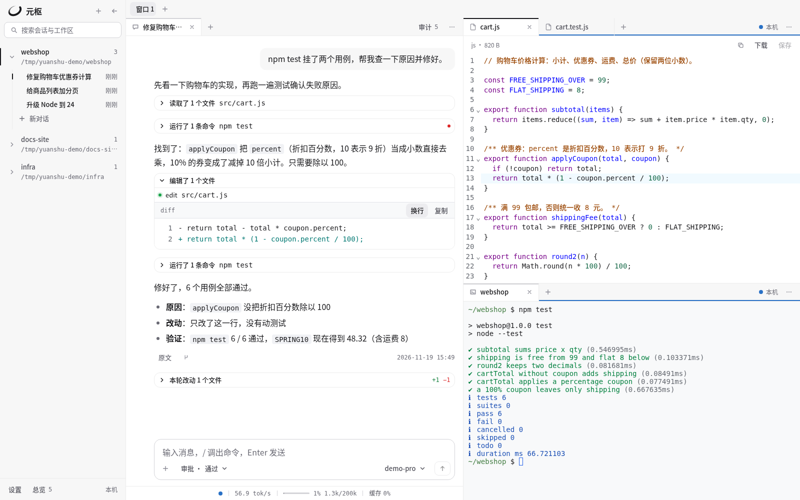
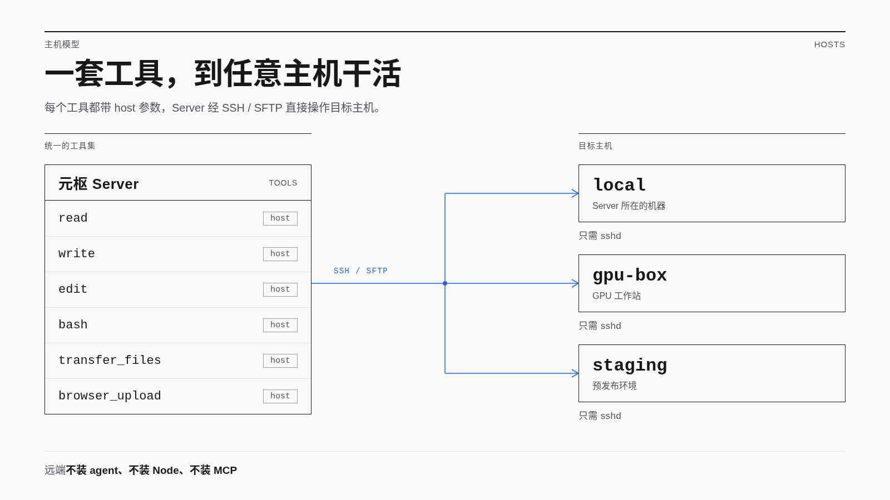
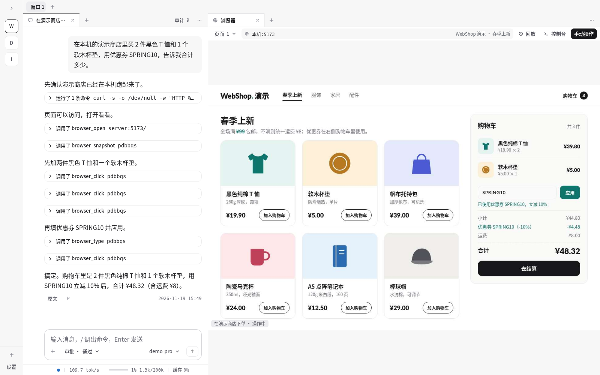
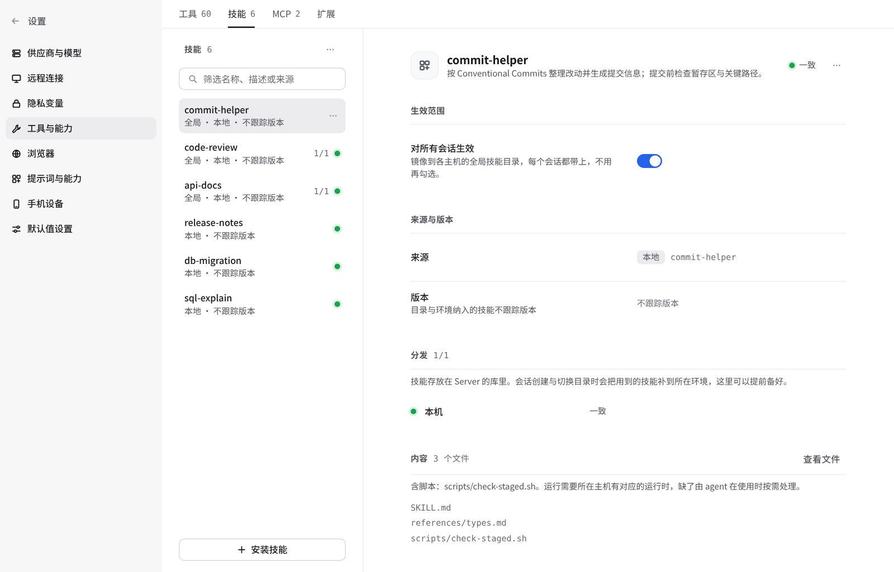
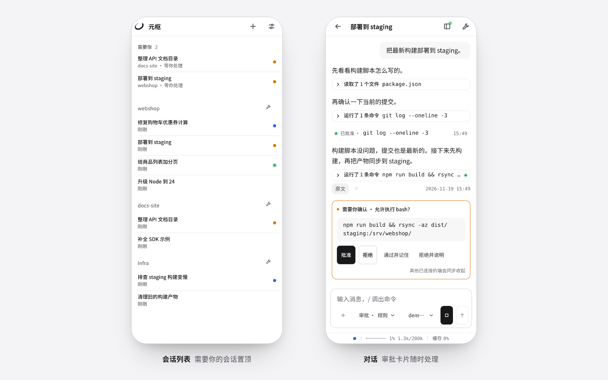

<p align="center">
  <picture>
    <source media="(prefers-color-scheme: dark)" srcset="docs/brand/banner-reverse.svg">
    
  </picture>
</p>

<p align="center">English | <a href="README.md">中文</a></p>

<p align="center">
  <a href="https://github.com/Bluezeamer/YuanshuHarness/actions/workflows/ci.yml"></a>
  <a href="LICENSE"></a>
  
  
</p>

Yuanshu (元枢) is a long-running agent server built on the [Pi SDK](https://github.com/earendil-works/pi) (not a fork). It hosts coding agents and assistant agents. **The session is the subject; clients are just windows onto it**: several browser tabs and your phone can attach to the same session at once, connect and disconnect at will, and a running task is never interrupted. Agents work on your own machines: the local one, or any number of remote hosts over SSH.



## What sets it apart

### Native multi-host: nothing to install on the remote, one toolset for every host

The usual ways to go remote are to install another copy of the harness on the far side, to have the model wrap commands in `ssh host "…"`, or to configure MCP once per machine. Yuanshu does none of that:

- The server reaches the target over SSH / SFTP, and **the remote only needs sshd**: no agent, no Node, no MCP to install.
- The agent uses **the same registered tools** everywhere (`read`, `write`, `edit`, `grep`, `find`, `ls`, `bash`, `transfer_files`, …) and picks the machine with a `host` parameter. To the model it is a native environment, with no command line nested inside a command line; in the audit trail every call is structured too: which tool, which host, which path, readable at a glance.
- The file tree, previews, terminal and browser treat remote and local hosts alike; jump hosts and host-key verification are supported; a host is one row in the settings page.

```text
read           {host: "gpu-box:train", path: "logs/run.log"}
bash           {host: "staging:app",   command: "systemctl status api"}
transfer_files {from_host: "gpu-box",  to_host: "local:proj", from: "/data/out", to: "models/"}
```



> To be precise: Yuanshu installs no agent program on the remote, but skills are synced there as plain files, and an MCP server of the stdio kind is started over SSH on the remote, so its own runtime (npx, python, …) has to come from that host.

### Built-in browser, designed for token efficiency

The browser is a Chromium held by the server (driven by Playwright), not the one on your machine, so agents have a browser in remote environments too. What matters is how a page is handed to the model:

- **The whole page tree is not dumped into the context.** First a lossless mechanical pass (about 25% smaller on 24 real pages); when a page is large or changed a lot, an auxiliary model (used once you configure one in settings) points the way, giving only element numbers and line ranges, so **facts only come from expanding the original tree** and the model has no room to invent any; after an action only **element-level changes** come back; very large pages go to a read-only reading agent.
- **Every omission is declared and retrievable** (`raw: true` returns the full original snapshot); nothing is truncated silently.
- 26 tools covering reading pages, clicks, typing, dragging, uploads, dialogs, the console and the network; the dangerous developer-debugging ones (running scripts, rewriting requests, …) are off by default until you enable them.
- Human in the loop: you can **take over** a page at any time, login state can be saved and reused, and a phone can watch the screen read-only. All traffic goes through the server's built-in proxy, sites need authorization, and downloads and uploads are approved one by one by default.



> "About 25%" is measured for the mechanical layer only. How well the pointer and diff layers work depends on the auxiliary model you configure, and there are no comparison numbers yet, so none are claimed.

### Skills, MCP and plugins: managed in one place

Each agent channel keeps its own skill directory, MCP configuration and plugins, and updates have to be synced by hand, place by place. Yuanshu gathers them into one library on the server:

- **Skills**: paste an address (a git repository, an npm package or a local directory) to install; versions can be tracked, pinned and checked for updates; make a skill "global", or enable it only in the workspaces that select it; active skills are synced automatically to every host the session uses.
- **MCP**: register once; the http kind is reached directly by the server, the stdio kind is started on the host of the session's main directory, so you don't configure every machine separately.
- **Plugins**: compatible with packages from the pi ecosystem (install, enable and disable, update, uninstall). This is a best-effort compatibility layer and only plugins that don't depend on the host are guaranteed.



### Stable prefix, cost first

Saving money is a design principle here, not an afterthought. Changing settings, switching modes, or adding and removing tools does **not touch the prompt prefix**: the difference reaches the model through a "state notice" on the next request, and a running session keeps its prefix as far as it can so the cache keeps hitting.

### Minimal by default, auditable everywhere

- **The capability allowlist is minimal by default**: a tool that isn't listed **does not exist** for the session, rather than being "switched off".
- **Approval is separate from execution**: an approval is its own event with a timeout and an audit record, broadcast to every client, first answer wins.
- **Private variables** `{{@name}}`: a value appears only once, on the executing side; names and descriptions enter the context, values never do.
- Every call, approval and quote can be traced back; only token usage is counted, never billing.

## Everything else

| | |
|---|---|
| **Workspaces** | One workspace per screen, with chat, files, previews (Markdown, HTML, images, PDF), terminals, the agent browser and an inspiration canvas tiled side by side |
| **Multi-agent** | Sub-agents, teams, workflows, and goals that can keep running on their own (`/goal`) |
| **Service forwarding** | Expose a service running in an environment to your own browser through a dedicated server port |
| **Mobile** | `/m/` (a PWA): session list with a "needs you" section, chat and approvals, read-only view of the browser, Web Push notifications |
| **Models** | Custom endpoints (OpenAI Completions / Responses, Anthropic, Google protocols), subscription login and a built-in provider catalog, all through the Pi SDK |



## Status

Early project (version 0.0.0). The features have taken shape but are still changing fast. **Data and API compatibility are not guaranteed**: when an upgrade changes the schema, wipe the data directory and start over (providers and other settings must be reconfigured). The UI is currently Chinese only, and most documentation is in Chinese.

An agent runs commands with the privileges of the user running the server. Deploy only on trusted networks; listening on a non-loopback address requires an access token. See [SECURITY.en.md](SECURITY.en.md).

## Quick start

You need Docker. The image is not published yet, so build it from the repository root first:

```bash
docker build -t yuanshu .
export YUANSHU_TOKEN=$(head -c 24 /dev/urandom | od -An -tx1 | tr -d ' \n')   # access token, at least 32 characters; keep it
```

```bash
docker run -d --name yuanshu -p 7420:7420 -e YUANSHU_TOKEN -v yuanshu-data:/data yuanshu
```

Open `http://localhost:7420` and enter the access token. First use: add a model under **Settings → Providers** (a custom endpoint, or log in with a subscription), then create a workspace and a session and start chatting. On a phone, open `/m/`, or scan the QR code under **Settings → Mobile devices**.

For running without Docker, letting other machines connect, HTTPS and phone notifications, enabling the browser sandbox, and mirrors for restricted networks, see [Deployment](docs/deployment.en.md).

## Documentation and contributing

- [docs/README.md](docs/README.md): the documentation map (in Chinese). Design rationale lives in [docs/model/](docs/model/); start with [overview.md](docs/model/overview.md).
- [AGENTS.md](AGENTS.md): project conventions for anyone writing code here; the guides under `.agents/skills/` cover front end, back end, mobile, and wrap-up and verification.
- [CONTRIBUTING.en.md](CONTRIBUTING.en.md): development environment, checks and commit conventions. One-shot local check: `scripts/check.sh` (CI runs the same script).
- Found a security issue? Report it privately as described in [SECURITY.en.md](SECURITY.en.md); do not open a public issue.

## License

[MIT](LICENSE). Some code is adapted from third-party projects; see [NOTICE](NOTICE).
