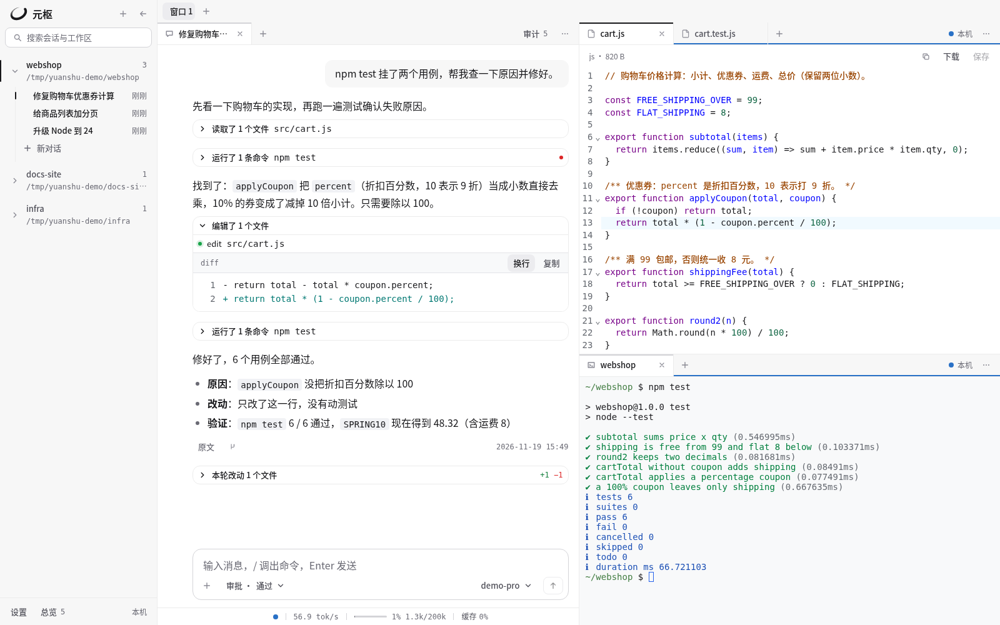
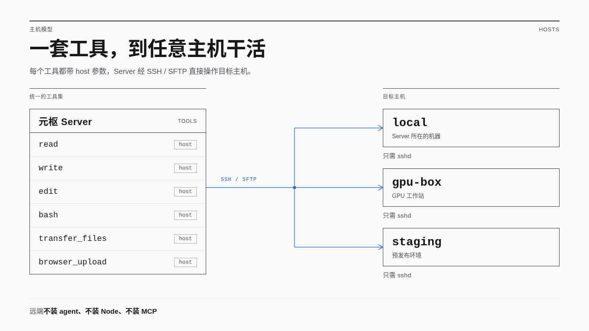
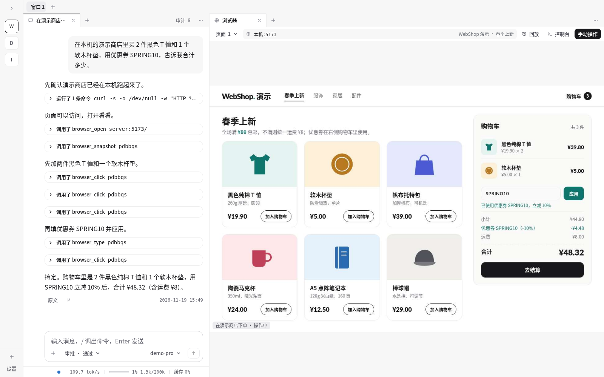
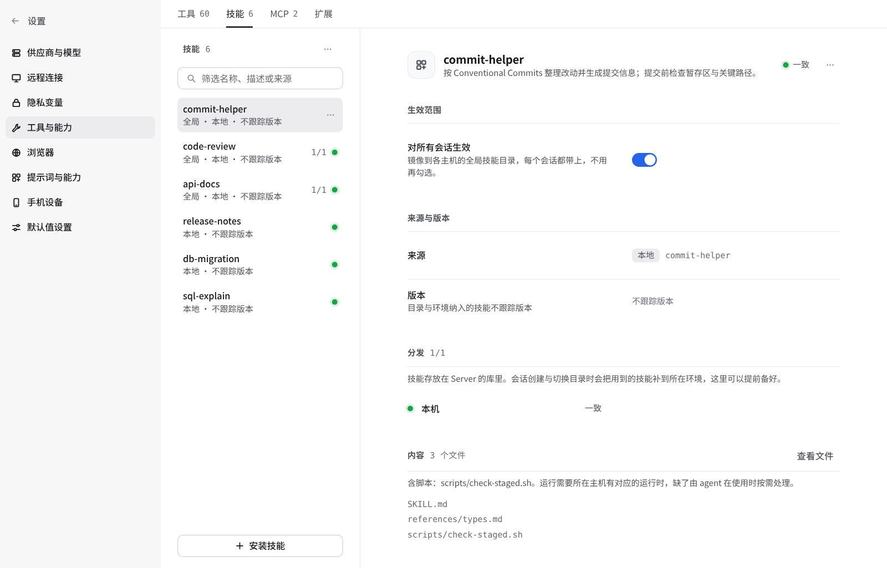
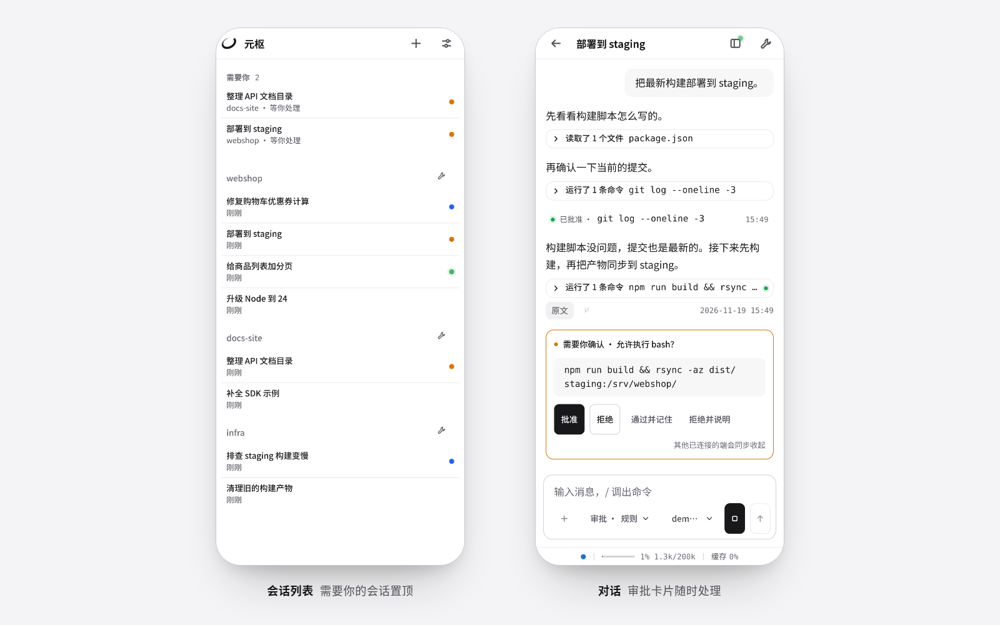

<p align="center">
  <picture>
    <source media="(prefers-color-scheme: dark)" srcset="docs/brand/banner-reverse.svg">
    
  </picture>
</p>

<p align="center"><a href="README.en.md">English</a> | 中文</p>

<p align="center">
  <a href="https://github.com/Bluezeamer/YuanshuHarness/actions/workflows/ci.yml"></a>
  <a href="LICENSE"></a>
  
  
</p>

元枢是一个常驻的 Agent Server：基于 [Pi SDK](https://github.com/earendil-works/pi)（不 fork），托管 coding agent 与助理 agent。**会话是主体，客户端只是视窗**：多个浏览器标签页、手机可以同时挂载同一条会话，随时接入与断开，正在跑的任务不会被打断。Agent 在你自己的机器上干活：本机，或经 SSH 连着的任意多台远程主机。



## 和别的 harness 不一样的地方

### 原生多主机：远端零安装，一套工具走遍所有主机

常见的远程做法，是在远端再装一份 harness，或者让模型把命令包进 `ssh host "…"`，或者每台机器各配一遍 MCP。元枢都不这样做：

- Server 经 SSH / SFTP 连到目标主机，**远端只需要 sshd**：不装 agent、不装 Node、不装 MCP。
- agent 用的是**同一套注册好的工具**（`read`、`write`、`edit`、`grep`、`find`、`ls`、`bash`、`transfer_files`……），靠 `host` 参数指向哪台机器。模型感知到的就是原生环境，没有「命令行里套命令行」；审计里每次调用也是结构化的：哪个工具、哪台主机、哪个路径，一眼能读。
- 文件树、预览、终端、浏览器对远端与本机一视同仁；支持跳板机、主机密钥核对；一台主机就是设置页里的一行。

```text
read           {host: "gpu-box:train", path: "logs/run.log"}
bash           {host: "staging:app",   command: "systemctl status api"}
transfer_files {from_host: "gpu-box",  to_host: "local:proj", from: "/data/out", to: "models/"}
```



> 准确地说：元枢不往远端装任何 agent 程序，但技能会作为普通文件同步过去，MCP 的 stdio 进程经 SSH 起在远端，它自己的运行时（npx、python 等）要由那台主机提供。

### 内置浏览器：为 token 效率而设计

浏览器是 Server 持有的 Chromium（Playwright 驱动），不是你本机的，所以 agent 在远程环境里也有浏览器可用。重点是页面怎么交给模型：

- **不把整棵页面树塞进上下文。** 先做无损的机械压缩（24 个真实页面实测省约 25%）；页面大或变化大时，由辅助模型（在设置里配好才启用）「指路」，只给元素编号与行区间，**事实只来自原页面树的展开**，模型没有机会编造；操作之后只回**元素级的变化**；特别大的页面交给只读的阅读 agent。
- **任何省略都声明，并且可取回**（`raw: true` 给完整原始快照），没有静默截断。
- 26 个工具，覆盖读页面、点击、输入、拖拽、上传、对话框、控制台与网络；危险的开发调试类（执行脚本、改请求等）默认关闭，要勾选才启用。
- 人机协作：你随时可以**接管**页面，登录态可以保存复用，手机上能只读看画面。所有流量经 Server 内置代理，访问站点要授权，下载与上传默认逐次审批。



> 「省约 25%」是机械压缩层的实测。指针与差异这两层的效果取决于你配的辅助模型，目前没有对比数字，所以不写。

### 技能、MCP、插件：一处统一管理

各个 agent 渠道的技能目录、MCP 配置、插件各管各的，更新要一处处手动同步。元枢把它们收成 Server 上的一份库：

- **技能**：粘贴一个地址（git 仓库、npm 包或本地目录）就能装；版本可跟踪、可锁定、可检查更新；设成「全局」，或只在被勾选的工作区里生效；生效的技能自动同步到会话所在的每台主机。
- **MCP**：登记一次，http 型由 Server 直连，stdio 型在会话主目录所在的主机上启动，不必在每台机器各配一遍。
- **插件**：兼容 pi 生态的包（安装、启停、更新、卸载）。这是尽力而为的兼容层，只保证与主机无关的插件。



### 前缀稳定，成本优先

省钱写进设计原则，不是事后优化。设置变了、切模式、增删工具，都**不改动提示词前缀**：差异通过一条「状态通知」在下一次请求里告诉模型，进行中的会话尽力保持前缀，让缓存继续命中。

### 默认最小，处处可审计

- **能力白名单默认最小**：没列出的工具对会话来说**不存在**，而不是「关着」。
- **审批与执行分离**：审批是独立事件，有超时、有审计，多端广播、先答先赢。
- **隐私变量** `{{@名称}}`：值只在执行端出现一次，名字与描述进上下文，值不进。
- 每次调用、审批与引用都能回溯；只统计 token 用量，不碰计费。

## 其余功能

| | |
|---|---|
| **工作区** | 一屏一工作区，平铺窗格里同时摆对话、文件、预览（Markdown、HTML、图片、PDF）、终端、agent 浏览器与灵感画布 |
| **多智能体** | 子代理、团队、工作流，以及可自主续跑的目标（`/goal`） |
| **服务转发** | 把环境里跑着的服务，经 Server 的独立端口交给你自己的浏览器使用 |
| **手机端** | `/m/`（PWA）：会话列表与「需要你」区、对话与审批、只读看浏览器画面、Web Push 通知 |
| **模型** | 自定义端点（OpenAI Completions / Responses、Anthropic、Google 协议）、订阅登录与内置供应商目录，经 Pi SDK 接入 |



## 当前状态

早期项目（版本 0.0.0）：功能已经成形，但还在快速变化。**不保证数据与接口兼容**：升级时表结构变了，要清空数据目录重建（供应商等配置要重配）。界面目前只有中文，文档以中文为主。

Agent 会以运行 Server 的用户的权限执行命令。请只在受信任的网络里部署，监听非回环地址必须配访问令牌，详见 [SECURITY.md](SECURITY.md)。

## 快速开始

需要 Docker。镜像尚未发布，先在仓库根目录本地构建：

```bash
docker build -t yuanshu .
export YUANSHU_TOKEN=$(head -c 24 /dev/urandom | od -An -tx1 | tr -d ' \n')   # 访问令牌，至少 32 个字符，请记下
```

<!-- smoke:docker-run -->
```bash
docker run -d --name yuanshu -p 7420:7420 -e YUANSHU_TOKEN -v yuanshu-data:/data yuanshu
```

浏览器打开 `http://localhost:7420`，输入访问令牌进入。第一次使用：**设置 → 供应商**里添加一个模型（填自定义端点，或用订阅登录），再新建工作区、新建会话，就可以对话了。手机上打开 `/m/`，或在 **设置 → 手机设备** 里扫码添加。

不用 Docker、要让别的机器访问、要 HTTPS 与手机通知、要让浏览器沙箱生效、国内网络怎么换镜像源：见 [部署与运行](docs/deployment.md)。

## 文档与参与

- [docs/README.md](docs/README.md)：文档地图。设计依据在 [docs/model/](docs/model/)，从 [overview.md](docs/model/overview.md) 读起。
- [AGENTS.md](AGENTS.md)：在本仓库写代码要遵守的项目约定；`.agents/skills/` 下是前端、后端、手机端与收尾验收的写法指南。
- [CONTRIBUTING.md](CONTRIBUTING.md)：开发环境、检查与提交约定。本地一键检查：`scripts/check.sh`，CI 跑同一份。
- 发现安全问题请按 [SECURITY.md](SECURITY.md) 私下报告，不要开公开 issue。

## 许可

[MIT](LICENSE)。部分代码改写自第三方项目，见 [NOTICE](NOTICE)。
